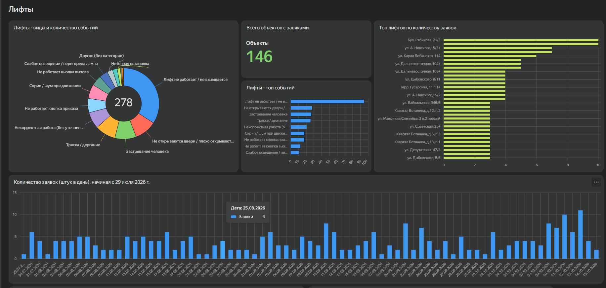
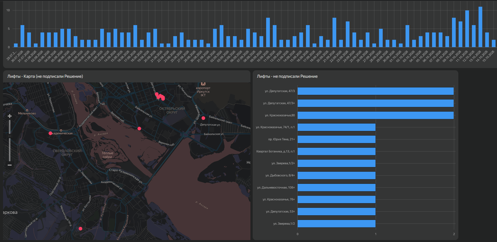

# Систематизация учёта лифтового оборудования и разработка аналитического прототипа в Yandex DataLens

**Тип проекта:** pet-project на основе рабочего опыта.

Самостоятельный проект на основе рабочих данных: структурирование сведений о лифтовом оборудовании, организация учёта ремонтов, документов и диспетчерских событий, а также создание демонстрационного аналитического дашборда.

Рабочие таблицы используются для текущего учёта и контроля. Дашборд создан по собственной инициативе как прототип для исследования данных и демонстрации возможностей визуализации.

## Контекст и задача

В рамках работы с лифтовым оборудованием требовалось систематизировать технические сведения, информацию о договорах, выполненных работах и оплатах. Эти данные нужны для текущего учёта и контроля, поэтому важно было организовать их в понятную структуру и учитывать индивидуальные условия расчётов.

Практической основой проекта стала система учёта в Google Таблицах. В дальнейшем по собственной инициативе был разработан аналитический прототип в Yandex DataLens.

## Цель проекта

Систематизировать сведения о лифтовом оборудовании и связанных с ним процессах, а также исследовать возможности использования накопленных данных для аналитики и визуального контроля.

## Рабочее решение и аналитический прототип

В проекте выделены две части:

- **Рабочий учёт в Google Таблицах** — организация и ведение данных для повседневных задач.
- **Аналитический прототип в Yandex DataLens** — демонстрация возможностей анализа и визуализации этих данных.

Дашборд не представлен как внедрённая производственная система. Его назначение — исследовать данные и показать возможное развитие аналитической части проекта.

## Мой вклад

Проект вырос из повседневных рабочих задач. Я самостоятельно организовал учёт в Google Таблицах, а затем использовал накопленные данные для разработки аналитического прототипа.

В рамках проекта я:

- **Систематизировал сведения о лифтовом оборудовании** — собрал и структурировал данные для дальнейшего ведения учёта.
- **Организовал учёт ремонтов, документов и диспетчерских событий** — подготовил рабочие реестры для текущего контроля.
- **Настроил инструменты работы с таблицами** — использовал ВПР, ПРОСМОТРX, сводные таблицы, проверку данных и условное форматирование.
- **Подготовил данные для визуализации** — выполнил очистку и структурирование записей.
- **Разработал прототип дашборда в Yandex DataLens** — представил анализ обращений и географию объектов.

Таким образом, моя работа охватывала как организацию исходного учёта, так и подготовку данных и создание аналитического прототипа.

## Демонстрация проекта

### Реестр лифтового оборудования

Основа проекта — структурированная база лифтового оборудования. В ней собраны адреса объектов, технические характеристики, сроки следующего освидетельствования, замечания и отметки об их устранении.

### Учёт ремонтов и документов

Рабочий реестр объединяет сведения о ремонтах, материалах и работах, их стоимости и движении сопутствующих документов — от подготовки актов, калькуляций и спецификаций до бухгалтерских документов и оплаты.

Условное форматирование помогает различать статусы. С помощью ПРОСМОТРX из базы оборудования подтягиваются характеристики конкретного лифта для дальнейшего переноса в акт осмотра.

### Аналитический прототип в Yandex DataLens

Дашборд создан по собственной инициативе для исследования данных и демонстрации возможностей визуализации. В отличие от рабочих таблиц, он не внедрён в повседневный контроль.

На дашборде представлены распределение диспетчерских событий по категориям, объекты с наибольшим количеством заявок и ежедневная динамика обращений.

Дополнительные блоки показывают географию объектов и количество ремонтов, по которым ещё не подписано решение совета дома.

