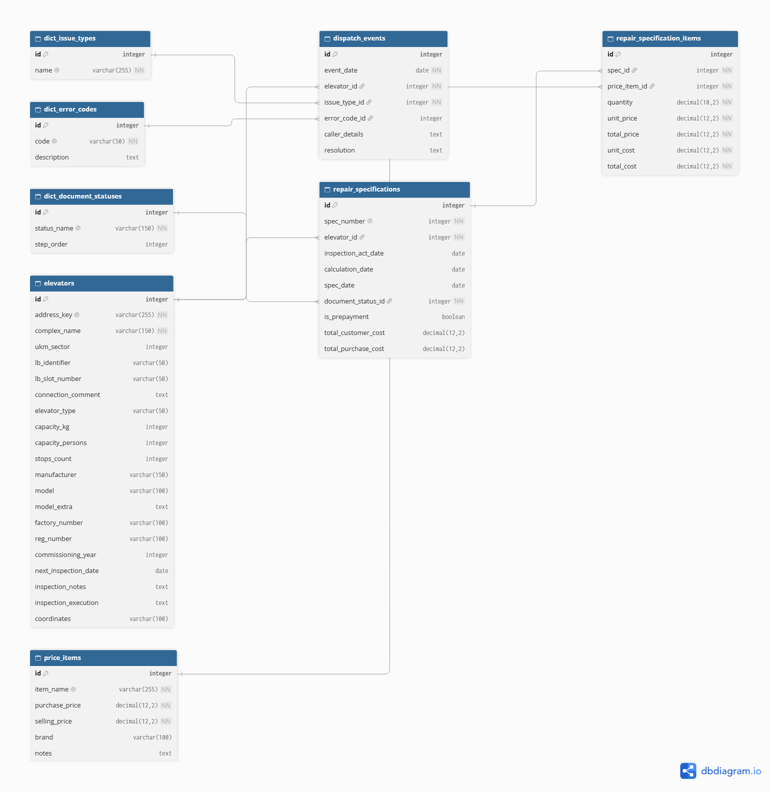

## Архитектура данных (Data Architecture)

В основу системы заложена реляционная модель данных, нормализованная до 3NF. Модель устраняет дублирование информации о парке оборудования и регламентирует жизненный цикл заявок и ремонтов.

### Структура сущностей и бизнес-логика:

1. **Реестр оборудования (`elevators`)** — паспортные данные лифтов: адреса, сектора УК, типы оборудования, грузоподъемность, заводские и регистрационные номера, даты следующего технического освидетельствования (ТОсв) и геокоординаты для визуализации в BI.
2. **Журнал инцидентов (`dispatch_events`)** — учет аварийных заявок с привязкой к классификаторам неполадок и кодам ошибок станций управления. Позволяет выявлять системные сбои и рецидивы по оборудованию.
3. **Управление сметами и ремонтами (`repair_specifications` и `repair_specification_items`)**:
   - Шапка спецификации хранит связку с лифтом, даты осмотра и расчета, статус согласования комплекта документов и признак авансирования.
   - Табличная часть связывает ремонт с утвержденным прайс-листом (`price_items`), рассчитывает себестоимость и итоговую сумму для заказчика.
4. **Нормализованные справочники (`dict_*`)**:
   - `dict_issue_types` — типология неисправностей.
   - `dict_error_codes` — кодификатор ошибок станций (УКЛ, УЛ, OTIS и др.).
   - `dict_document_statuses` — воронка согласования документов (от дефектного акта до оплаты).
